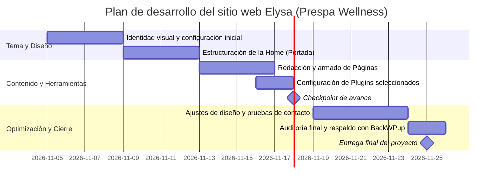

# Decisiones de mi sitio

**Emprendimiento:** Elysa  
**Fecha:** 4 de noviembre de 2026 · **Última corrección:** 4 de noviembre de 2026  

---

## 1. Plugins (10 pts)

Al menos **5 plugins**, cada uno vale 2 pts. **SEO** y **contacto** son obligatorios; los otros 3 los eliges según lo que necesita tu sitio (parte de `docs/03-funcionalidades.md`). Guía: `guia-investigar-plugins.md`.

| # | Funcionalidad | Plugin | Gratis o de pago | Qué incluye la versión gratis | Probado hasta (WP) | Requiere PHP | ¿Funciona con tema propio? | Enlace a la ficha |
|---|---|---|---|---|---|---|---|---|
| 1 | SEO (obligatorio) | Yoast SEO | Gratis (Freemium) | Optimización de títulos y meta descripciones, análisis SEO y de legibilidad en tiempo real, generación automática de mapa de sitio XML (sitemaps), datos estructurados Schema.org y control de URLs canónicas. | 6.7 | 7.4 o superior | Sí (inyecta metas vía `wp_head()`) | [Yoast SEO](https://wordpress.org/plugins/wordpress-seo/) |
| 2 | Contacto (obligatorio) | Contact Form 7 | Gratis (100% open source) | Creación y administración ilimitada de formularios de contacto personalizados, soporte de campos flexibles (texto, correo, selector, mensaje), envío por correo, compatibilidad con reCAPTCHA y filtro anti-spam. | 6.7 | 7.4 o superior | Sí (se inserta con shortcode en páginas o bloques) | [Contact Form 7](https://wordpress.org/plugins/contact-form-7/) |
| 3 | Copias de seguridad (Respaldo) | BackWPup | Gratis (Freemium) | Respaldo completo de la base de datos MySQL, respaldo de archivos del sitio (`wp-content`, plugins, temas y subidas), compresión en .zip/.tar, exportación XML y guardado en servidor, Dropbox o descarga directa. | 6.7 | 7.4 o superior | Sí (opera a nivel de archivos y base de datos) | [BackWPup](https://wordpress.org/plugins/backwpup/) |
| 4 | Filtro Anti-spam | Akismet Anti-spam | Gratis (Freemium para sitios personales) | Detección y bloqueo automático de spam en los comentarios del blog, historial de estado de cada comentario, descarte directo de spam severo e integración nativa con Contact Form 7. | 6.7 | 7.2 o superior | Sí (funciona con la plantilla nativa de comentarios y hooks estándar) | [Akismet Anti-spam](https://wordpress.org/plugins/akismet/) |
| 5 | Redes sociales (Compartir) | AddToAny Share Buttons | Gratis (100% gratuito) | Botones para compartir en más de 100 redes sociales y mensajería (WhatsApp, Facebook, Instagram, Telegram, Pinterest), barras flotantes y fijas, diseño responsive, contador de compartidos y soporte de shortcodes. | 6.7 | 5.6 o superior | Sí (se inserta vía `the_content`, bloques o shortcode) | [AddToAny Share Buttons](https://wordpress.org/plugins/add-to-any/) |

### Detalle y justificación de cada plugin para Elysa

1. **Yoast SEO**
   - **Funcionalidad y motivo de elección para Elysa:** Posicionar los servicios de bienestar integral y terapias holísticas (Reiki, Tameana, Flores de Bach, Tarot terapéutico y Péndulo Hebreo) en los motores de búsqueda como Google, permitiendo que potenciales consultantes que busquen autocuidado y equilibrio emocional encuentren a Elysa de manera orgánica.
   - **Modelo de licencia:** Gratuito (Freemium con versión Premium opcional). La versión gratuita cubre ampliamente todas las necesidades del proyecto.
   - **Compatibilidad técnica:** Probado hasta WordPress 6.7 y requiere PHP 7.4 o superior. Compatible al 100% con temas descargados (Prespa Wellness) y temas propios mediante el hook estándar `wp_head()`.
   - **Alternativa compatible en caso de fallo:** *Rank Math SEO* o *All in One SEO*.

2. **Contact Form 7**
   - **Funcionalidad y motivo de elección para Elysa:** Proveer un canal de comunicación directo, claro y accesible para que los usuarios puedan agendar consultas, solicitar información sobre sesiones terapéuticas o encargar preparados personalizados de Flores de Bach sin fricción.
   - **Modelo de licencia:** 100% gratuito (GPLv2).
   - **Compatibilidad técnica:** Probado hasta WordPress 6.7 y requiere PHP 7.4 o superior. Funciona con cualquier tema mediante el shortcode `[contact-form-7 ...]`.
   - **Alternativa compatible en caso de fallo:** *WPForms Lite*.

3. **BackWPup**
   - **Funcionalidad y motivo de elección para Elysa:** Garantizar la seguridad, integridad y continuidad del sitio web ante eventuales caídas, errores humanos o límites de almacenamiento del hosting gratuito InfinityFree, permitiendo respaldar la base de datos y los archivos del sitio.
   - **Modelo de licencia:** Gratuito (Freemium con versión Pro opcional). La versión gratis permite respaldar la base de datos y archivos esenciales.
   - **Compatibilidad técnica:** Probado hasta WordPress 6.7 y requiere PHP 7.4 o superior. Funciona de manera independiente al tema visual utilizado.
   - **Alternativa compatible en caso de fallo:** *UpdraftPlus Backup and Restoration*.

4. **Akismet Anti-spam**
   - **Funcionalidad y motivo de elección para Elysa:** Proteger la sección de comentarios del Blog de bienestar y los formularios de contacto de bots automatizados y mensajes publicitarios maliciosos, preservando una imagen profesional y de confianza.
   - **Modelo de licencia:** Gratuito para sitios personales y no comerciales mediante clave API gratuita de Akismet.
   - **Compatibilidad técnica:** Probado hasta WordPress 6.7 y requiere PHP 7.2 o superior. Compatible con temas descargados y personalizados.
   - **Alternativa compatible en caso de fallo:** *Antispam Bee*.

5. **AddToAny Share Buttons**
   - **Funcionalidad y motivo de elección para Elysa:** Facilitar que la comunidad comparta los artículos educativos del Blog sobre autocuidado, salud emocional y terapias holísticas en WhatsApp y redes sociales, amplificando el alcance orgánico de la marca.
   - **Modelo de licencia:** 100% gratuito (sin costos ocultos ni suscripciones).
   - **Compatibilidad técnica:** Probado hasta WordPress 6.7 y requiere PHP 5.6 o superior. Totalmente compatible con cualquier tema mediante bloques, shortcode o ganchos de contenido.
   - **Alternativa compatible en caso de fallo:** *Sassy Social Share*.

---

## 2. Páginas de la fase 1 (5 pts)

**5 páginas**, 1 pt cada una. **Inicio** y **Contacto** son obligatorias; las otras 3 las eliges (no pueden ser del carro de compras).

| # | Página | Por qué la elijo (una línea) |
|---|---|---|
| 1 | Inicio (obligatoria) | Presenta la propuesta de valor de Elysa, una cálida bienvenida al bienestar integral y accesos directos a los servicios destacados y artículos del blog. |
| 2 | Contacto (obligatoria) | Facilita la comunicación directa a través del formulario de Contact Form 7 para consultas de sesiones, pedidos florales y dudas de consultantes. |
| 3 | Nosotros | Da a conocer la filosofía holística, historia, misión y valores de Elysa, generando empatía y confianza en personas interesadas en el autocuidado. |
| 4 | Servicios | Expone detalladamente las terapias ofrecidas (Reiki, Tameana, Tarot terapéutico, Péndulo Hebreo y Flores de Bach), explicando su propósito y beneficios. |
| 5 | Blog | Publica artículos educativos sobre equilibrio emocional y salud energética, educando a la audiencia y mejorando el posicionamiento SEO del emprendimiento. |

**Páginas y funcionalidades que dejo para después (fase posterior):**
- **Tienda online de productos:** Catálogo con precios y compra directa de preparados florales personalizados y complementos de bienestar.
- **Carrito de compras y pasarela de pago:** Integración de Webpay, Transbank o Mercado Pago para pagos automatizados.
- **Sistema de reservas de citas online:** Calendario interactivo con selección de horarios y confirmación automática para sesiones terapéuticas (ej. con plugin de reservas).
- **Cuestionario interactivo:** Formulario dinámico de orientación emocional para guiar al usuario hacia la terapia o preparado floral más adecuado.
- **Sección de testimonios interactivos:** Muro de reseñas y valoraciones de consultantes que han experimentado las terapias de Elysa.

---

## 3. Plan del tema (5 pts)

- **Nombre del tema:** Prespa Wellness ([Ficha en WordPress.org](https://wordpress.org/themes/prespa-wellness/))
- **Custom o descargado:** Tema descargado (child theme gratuito de Prespa en el repositorio oficial de WordPress.org).
- **Por qué:** Se eligió porque su diseño está enfocado específicamente en salud, bienestar y terapias, ofreciendo una estética armónica, limpia y adaptable que permite exhibir los servicios y contenidos de Elysa de manera profesional y atractiva sin requerir constructores visuales pesados ni desarrollo desde cero.
- **Carta Gantt** del desarrollo del sitio (5 al 25 de noviembre de 2026):

| Etapa | Desde | Hasta | Notas |
|---|---|---|---|
| Identidad visual y configuración del tema | 05 nov | 08 nov | Instalación y activación de Prespa Wellness, configuración de logo, paleta de colores y tipografías en el Personalizador. |
| Home (Portada) | 09 nov | 12 nov | Estructuración de la portada con sección hero, presentación del bienestar holístico y llamadas a la acción. |
| Creación de Páginas | 13 nov | 16 nov | Redacción y diagramación de las páginas Nosotros, Servicios, Blog y Contacto. |
| Instalación y configuración de Plugins | 16 nov | 17 nov | Instalación, activación y parametrización de Yoast SEO, Contact Form 7, BackWPup, Akismet y AddToAny. |
| **Checkpoint (18 nov)** | 18 nov | 18 nov | **Hito de revisión intermedia:** comprobación del sitio en producción, menú principal funcional y primeras páginas operativas. |
| Ajustes, formulario y optimización | 19 nov | 23 nov | Pruebas de envío en Contact Form 7, optimización de textos y títulos con Yoast SEO, pruebas de diseño responsive y publicación de entradas del blog. |
| Auditoría final y respaldo | 24 nov | 25 nov | Verificación de enlaces, revisión de velocidad/rendimiento, limpieza del panel y respaldo de seguridad con BackWPup. |
| **Entrega final (25 nov)** | 25 nov | 25 nov | **Hito de cierre:** sitio WordPress completamente operativo en InfinityFree, documentación final y entrega por AVA. |

### Diagrama Mermaid del cronograma

---

## 4. Plan B (5 pts)

Qué hago si algo no funciona. **Al menos 3 riesgos**, cada uno con su mitigación y cuándo se activa.

| Riesgo | Qué hago | Cuándo se activa (fecha o señal) |
|---|---|---|
| **Problemas de compatibilidad o visualización del tema Prespa Wellness** | Probar ajustes en el Personalizador y aplicar estilos mediante CSS adicional. Si el tema causa errores de maquetación severos o incompatibilidad con bloques, activar inmediatamente un tema de respaldo estándar como *Astra* o *Twenty Twenty-Four*, reasignando el menú y la página estática de inicio en menos de 24 horas. | Al instalar y activar el tema en InfinityFree (entre el 5 y 8 de noviembre), o si se detecta un error de renderizado irrecuperable. |
| **Un plugin falla, entra en conflicto o no es compatible** | Desactivar el plugin afectado de inmediato desde el panel de WordPress o renombrando su carpeta vía Administrador de Archivos de InfinityFree. Cambiar a su alternativa comprobada (ej. si falla *Contact Form 7* pasar a *WPForms Lite*; si falla *Yoast SEO* pasar a *Rank Math SEO*; si falla *BackWPup* pasar a *UpdraftPlus*). | Al momento de instalar/activar el plugin o si arroja error fatal durante las pruebas de la etapa de plugins (16 al 17 de noviembre). |
| **El correo del formulario de contacto no llega o es bloqueado** | Verificar la configuración de etiquetas y destinatario en Contact Form 7. Si InfinityFree bloquea la función nativa `mail()` de PHP, instalar y configurar el plugin gratuito *WP Mail SMTP* enlazado a una cuenta de correo externa (Gmail con contraseña de aplicación). Como medida de respaldo adicional inmediata, añadir en la página de Contacto un botón directo a WhatsApp y el correo de contacto visible en texto. | Durante las pruebas del formulario de contacto (19 al 21 de noviembre), o antes del Checkpoint (18 de noviembre) si la prueba de envío falla. |
| **Errores de servidor de InfinityFree (error 500, 429 o saturación de recursos)** | Los errores 429 y 500 en InfinityFree suelen ser temporales por límites de peticiones por hora; esperar de 15 a 30 minutos antes de reintentar. Si la falla persiste, continuar trabajando contenidos y maquetación en Local WP y restaurar la base de datos y archivos usando el respaldo previo de *BackWPup* o la herramienta de exportación nativa de WordPress. | Si el error 500/429 dura más de 1 hora consecutiva, o ante cualquier pérdida de datos en el servidor de producción. |

---

## Cambios respecto de la Sumativa 2 (solo en el checkpoint del 18 nov)

*(Esta sección se completará durante la Entrega 3 el miércoles 18 de noviembre de 2026, documentando los ajustes reales surgidos durante la implementación).*

| Qué cambié | Qué había antes | Por qué | Evidencia (captura o commit) |
|---|---|---|---|
| *(Pendiente para Checkpoint)* | *(Pendiente para Checkpoint)* | *(Pendiente para Checkpoint)* | *(Pendiente para Checkpoint)* |

**Decisión:** Continúo con la propuesta planificada del tema Prespa Wellness y los 5 plugins seleccionados. En el Checkpoint del 18 de noviembre se evaluará si se requiere pivotear o si se ratifica la implementación en curso.

